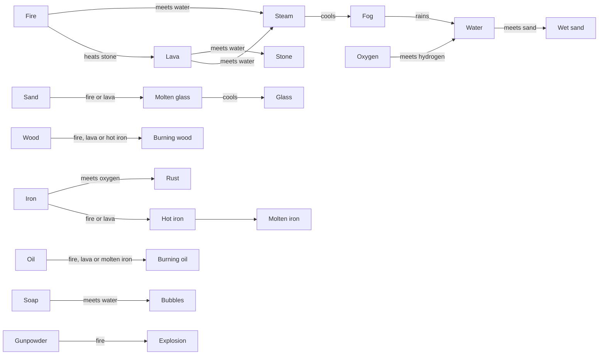

<div align="center">

# Falling Sand

### 360 000 cells, about 30 materials, a few rules each, written in plain C.

Pour sand, flood it, set it on fire, drop acid on it. Every grain follows a few local rules, and rivers, glass, rust and explosions come out of them.


<p>


</p>

[Build](#build-and-run) · [Materials](#the-palette) · [Reactions](#reactions) · [Gallery](#gallery) · [How it works](#how-it-works) · [Controls](#controls)

</div>

---

## Build and run

You need a C compiler, `make`, and the X11 development headers (`libx11` and `libxext`; on Debian/Ubuntu, `libx11-dev libxext-dev`). MiniLibX and libft are bundled.

```bash
git clone https://github.com/gecarval/Falling-Sand.git
cd Falling-Sand
make
./render
```

Pick a material with a letter key, **left-click** to start painting and **right-click** to stop.

## The palette

Each letter on the keyboard is a material. The material IDs are ordered from lightest to heaviest, and that order *is* the physics: see [How it works](#how-it-works).

| Kind | Key → material | How it moves |
|---|---|---|
| **Powders** | `W` Sand · `E` Wet sand · `R` Stone · `T` Gunpowder · `Y` Soap · `O` Rust | fall, pile up and slide off slopes, with some inertia |
| **Solids** | `U` Wood · `I` Iron · `P` Glass | stay where you put them |
| **Liquids** | `A` Water · `S` Lava · `D` Oil · `F` Acid | fall, then spread sideways to find their level |
| **Gases** | `X` Oxygen · `C` Hydrogen · `V` Propane · `B` Steam | rise and drift |
| **Energy** | `Z` Fire · `N` Missile | burn, explode |
| **Life** | `G` Fly | buzzes around and multiplies on wood |
| **Eraser** | `Q` Empty | removes whatever it touches |

Some states only appear through reactions: smoke, fog, embers, burning wood and oil, hot and molten iron, molten glass and soap bubbles.

## Reactions



- **Acid** eats through every material except **glass**, and is slowly used up. Glass is the only container that holds it.
- **Oxygen, hydrogen and propane** catch fire next to flames or lava.
- A **missile** goes off in a much larger blast than gunpowder.

Most reactions happen with a probability each frame (for example lava turns nearby sand into glass 1 time in 10), so they spread unevenly and look natural.

## Gallery

| | |
|:---:|:---:|
|  |  |
| Soap makes bubbles in water | Acid dissolving material |
|  |  |
| Fire, lava and water | Oil burning |
|  |  |
| Gas and wood | Sand with inertia and collisions |
|  |  |
| Sand piling up | Water flowing |


<sub>Water keeps its momentum and fills the space it is poured into.</sub>

## How it works

The world is an **800 × 450 grid** (360 000 cells), shown in a 1600 × 900 window. Each cell holds one byte: the ID of the material in it.

**Density is the ID.** Material IDs start at `'0'` (empty) and go up from the lightest gases, through liquids, to the heaviest solids. A particle is allowed to move into a neighbouring cell when that cell's ID is **lower** than its own, and the two swap. That one comparison is why sand sinks through water and oil floats on top of it, without a single special case.

Each frame the grid is scanned from the bottom up. For each cell:

1. A **lookup table** indexed by material ID picks the update function. There is no `switch` and no chain of `if`s.
2. The function applies the movement rule for its kind:
   - **powders** try down, then the two diagonals, with a random chance to slide and some inertia;
   - **liquids** do the same, then flow left or right to level out;
   - **gases** do the opposite and rise.
3. It looks at the neighbours for reactions (water next to sand, fire next to wood, and so on) and rewrites cells.

A second lookup table, also indexed by ID, gives each material its colour when the grid is drawn.

The project also contains **Cubix**, a small rotating 3D wireframe cube drawn with Bresenham lines (`1` to toggle it, `↑` / `↓` for its speed).

```
main.c, calls.c, reads.c, tools.c   window, image, input, brush
fluidsim/
├── fluidsim.c                      grid scan, lookup tables, drawing
├── part_emul.c                     shared movement: powders, liquids, gases, flies
├── part_emul_solid.c               sand, wood, iron, rust, glass, gunpowder…
├── part_emul_liquid.c              water, lava, oil, acid, molten iron
├── part_emul_gas.c                 fire, smoke, steam, fog, oxygen, hydrogen, propane
├── part_emul_logic.c               neighbour search, explosions
└── part_call.c                     brush and material setters
cubix/                              3D cube demo
includes/renderer.h                 grid size, material IDs and colours
```

## Controls

| Key | Action | Key | Action |
|---|---|---|---|
| Letter keys | choose a material ([table](#the-palette)) | `,` / `.` | smaller / bigger brush |
| `LMB` | start painting | `[` / `]` | faster / slower simulation |
| `RMB` | stop painting | `Space` | clear the screen |
| `2` | falling sand on / off | `1` | 3D cube on / off |
| `Esc` | quit | `↑` / `↓` | cube speed |

## Background

A falling-sand game is a [cellular automaton](https://en.wikipedia.org/wiki/Cellular_automaton): a grid of cells, each with a small set of states and a rule that looks only at its neighbours. The best-known example is Conway's [Game of Life](https://en.wikipedia.org/wiki/Conway%27s_Game_of_Life). Falling-sand games swap its two states for dozens of materials, and its birth-and-death rules for gravity and chemistry.

---

<div align="center">

Released under the [BSD 2-Clause License](./LICENSE) · Made by [Gerson Carvalho](https://github.com/gecarval) at 42

</div>
